<table align="center">
  <tr>
    <td valign="top"></td>
    <td valign="top"></td>
  </tr>
</table>

  <h3>Software Engineering student at EFREI Paris</h3>
  
<i>Looking for a 12-month apprenticeship from November 2026, full time from March 2027.</i>

  

    
    
    
  

<h2>About me</h2>

- Engineering student in Software Engineering at **EFREI Paris**, starting my M2 in November 2026, after a scientific path (DUT Mesures Physiques, then a preparatory class).
- Five-month internship at **Thales AVS** (Training & Simulation): I designed and built a CMDB-style business tool with C#, ASP.NET Core, Angular and PostgreSQL.
- Projects in Python, Java / Spring Boot, AI (RAG) and DevOps, with automated tests.
- Currently building **FlightTracker** to level up on Java and Spring Boot.
- Outside of code: computer hardware, astronomy, tennis and fitness.

<h2>Tech stack</h2>

<table width="100%">
  <tr>
    <td width="50%" valign="top">
      <h4>Languages</h4>
      
      <h4>Backend & Frontend</h4>
      
      <h4>Databases</h4>
      
    </td>
    <td width="50%" valign="top">
      <h4>DevOps & Tools</h4>
      
      <h4>AI & Data</h4>
      
RAG · Mistral · embeddings · ChromaDB · Tesseract OCR · Presidio · NumPy · scikit-learn

      <h4>Testing & Methods</h4>
      
PyTest · JUnit 5 · Mockito · Jest · unit and integration tests · OOP (SOLID) · UML · Agile / Scrum

    </td>
  </tr>
</table>

<h2>Featured projects</h2>

<table width="100%">
  <tr>
    <td width="50%" valign="top">
      <h3><a href="https://github.com/ccao94/monitoring">Price monitoring & alerts</a></h3>
      
Multi-site price scraper based on structured page data (JSON-LD, microdata), with Telegram alerts when a price crosses a threshold and anti-bot page detection.

      
<code>Python</code> <code>FastAPI</code> <code>PostgreSQL</code> <code>Docker</code> <code>Kubernetes</code> <code>GitHub Actions</code> <code>PyTest</code>

      <ul>
        <li>REST API and online dashboard, ~50 tests against a real database</li>
        <li>CI/CD (lint, tests, Docker build), scheduled runs with a Kubernetes CronJob</li>
      </ul>
    </td>
    <td width="50%" valign="top">
      <h3><a href="https://github.com/ccao94/smartsoon">SmartSoon</a></h3>
      
RAG that analyzes medical documents (PDF, images) and produces structured reports with source citations, in partnership with SOON Expertise.

      
<code>Python</code> <code>Mistral</code> <code>ChromaDB</code> <code>Tesseract</code> <code>Presidio</code>

      <ul>
        <li>Project lead for a team of 6: sprints, technical follow-up and development</li>
        <li>OCR, anonymization (GDPR / HDS context), multilingual embeddings</li>
      </ul>
    </td>
  </tr>
  <tr>
    <td width="50%" valign="top">
      <h3><a href="https://github.com/ccao94/flighttracker">FlightTracker</a></h3>
      
Spring Boot REST API that tracks real aircraft by ICAO24 code, using ADS-B data from OpenSky Network. Ongoing.

      
<code>Java</code> <code>Spring Boot</code> <code>Spring Data JPA</code> <code>PostgreSQL</code> <code>JUnit 5</code> <code>Mockito</code>

      <ul>
        <li>Layered architecture, JPA persistence, containerized PostgreSQL</li>
        <li>Unit and web layer tests (JUnit 5, Mockito, MockMvc)</li>
      </ul>
    </td>
    <td width="50%" valign="top">
      <h3><a href="https://github.com/ccao94/portfolio">Portfolio</a></h3>
      
My personal website, bilingual French / English.

      
<code>React</code> <code>Vite</code> <code>Tailwind CSS</code> <code>Framer Motion</code>

      <ul>
        <li>All content in one data file, no i18n library</li>
        <li>Timeline drawn to scale, deployed on Vercel</li>
      </ul>
    </td>
  </tr>
</table>

<h2>Experience</h2>

<table width="100%">
  <tr>
    <td width="50%" valign="top">
      <h4>Thales AVS, Training & Simulation</h4>
      
<i>Functional engineer and developer intern · Jan to Mar 2026, Aug to Sep 2026</i>

      <ul>
        <li>Business requirements analysis and a data model of about 60 entities for a CMDB-style tool</li>
        <li>Role-based access (10 profiles), bulk export and re-import with integrity checks</li>
        <li>C#, ASP.NET Core, Angular, PostgreSQL</li>
      </ul>
    </td>
    <td width="50%" valign="top">
      <h4>CINEA</h4>
      
<i>Senior technician intern · Nov 2022 to Jan 2023</i>

      <ul>
        <li>Acoustic measurement campaigns on industrial sites and data analysis</li>
        <li>Technical reports, working with acoustic engineers</li>
      </ul>
    </td>
  </tr>
</table>

<h2>Education</h2>

- **EFREI Paris Panthéon-Assas**, engineering degree, Software Engineering major (2024 to 2027), including a 4-month exchange at Concordia University, Montreal
- **CPGE ATS**, industrial engineering, Lycée Robert Doisneau (2023 to 2024)
- **DUT Mesures Physiques**, IUT d'Orsay, Université Paris-Saclay (2020 to 2023)

<h2>GitHub activity</h2>

  
    
  <picture>
    <source media="(prefers-color-scheme: dark)" srcset="https://raw.githubusercontent.com/ccao94/ccao94/output/github-snake-dark.svg"/>
    
  </picture>

